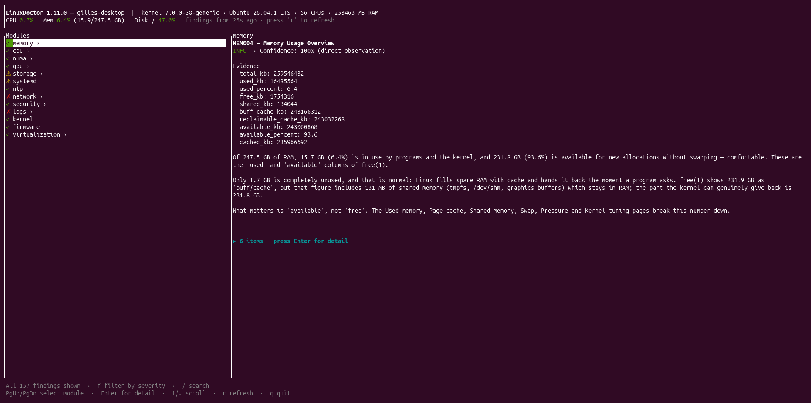

<!-- SPDX-License-Identifier: GPL-3.0-only -->

# LinuxDoctor

**Understand your Linux system, not just its metrics.**

LinuxDoctor is an open-source Linux diagnostic and auditing tool written in Rust. It examines a Linux system, looks for potential problems, explains why they may matter, and suggests possible next steps.

Instead of making you piece together information from many commands, LinuxDoctor brings findings from different parts of the system into one coherent report.

## Target environments

LinuxDoctor is designed for a wide range of Linux environments:

- **Desktop:** workstations and personal Linux computers.
- **Servers:** physical and virtual servers.
- **HPC and distributed systems:** compute nodes and infrastructure components.

LinuxDoctor runs its diagnostics locally on each machine; it is not a cluster orchestration tool.

## Linux distributions and packages

Prebuilt packages are provided in two formats:

- **`.deb`** — for Debian, Ubuntu and compatible derivatives.
- **`.rpm`** — for RPM-based distributions, including Fedora, Red Hat Enterprise Linux (RHEL), CentOS Stream, Rocky Linux, AlmaLinux and openSUSE.

Compatibility depends on the distribution version, architecture and available system dependencies. Not every distribution or version has necessarily been tested.

## Key principles

- **Read-only diagnostics:** LinuxDoctor does not change system configuration or execute suggested fixes.
- **Evidence-based findings:** diagnoses are based on observable system information, and limitations are made explicit.
- **Useful explanations:** findings describe their potential impact and suggest practical next steps.
- **Multiple output formats:** interactive terminal UI, terminal reports, JSON, Markdown and standalone HTML.
- **Local execution:** no external service or monitoring infrastructure is required.

[**Download the latest release**](https://github.com/gillesmagneville/linuxdoctor/releases/latest) · [Report a bug](https://github.com/gillesmagneville/linuxdoctor/issues) · [Read the documentation](#documentation)



## Why LinuxDoctor?

Linux already provides excellent tools such as `top`, `vmstat`, `journalctl`, `lscpu`, `lsblk` and `smartctl`.

The challenge is often not obtaining the data, but understanding what it means when several symptoms appear together.

LinuxDoctor aims to help answer three questions:

1. **What did the system report?**
2. **Why might it matter?**
3. **What should I investigate next?**

It is designed for Linux system administrators, HPC administrators, developers, support engineers and technically curious Linux users.

## What does it diagnose?

LinuxDoctor currently covers thirteen diagnostic areas:

| Area | Examples of checks |
|---|---|
| Memory | Memory usage, swap, pressure, OOM kills and kernel memory settings |
| CPU | Topology, load pressure, offline CPUs and CPU isolation |
| Storage | Filesystem capacity, inodes, SMART health, software RAID and read-only remounts |
| NUMA | Per-node CPU and memory information, usage balance and topology asymmetry |
| GPU | GPU inventory, available telemetry, temperatures and driver-related information |
| Systemd | Overall system-manager state and failed units |
| Time synchronization | System clock synchronization and RTC mode |
| Virtualization | Virtual-machine and container inventory, when the relevant tools are available |
| Network | Interfaces, errors and drops, routes, DNS, bonds and connection tracking |
| Security | Listening services, firewall visibility, SSH configuration, access control and hardening |
| Logs | Authentication failures, system errors, kernel messages and journal configuration |
| Kernel | Taint status, OOM history, boot parameters and system-wide resource tables |
| Firmware | BIOS/UEFI information, Secure Boot, virtualization extensions, IOMMU and TPM presence |

The available information depends on the machine, kernel, permissions and installed tools. LinuxDoctor reports when a check cannot be completed instead of treating missing information as proof that everything is healthy.

## Reports and interface

LinuxDoctor provides several ways to inspect and use its results:

- **Interactive TUI:** navigate findings by module and topic in the terminal.
- **Terminal report:** inspect diagnostic findings directly.
- **JSON:** integrate results into scripts or other tools.
- **Markdown:** produce a report that can be read, shared or attached to a ticket.
- **HTML:** generate a self-contained report that can be opened in a browser without an external service.
- **Report comparison:** compare two JSON reports to see what changed between audits.

Findings include severity and supporting information. Where relevant, LinuxDoctor also explains uncertainty or missing visibility. Suggested commands are provided for the user to review; they are not executed automatically.

## Quick start

### Option 1: Download a release

Prebuilt `.deb` and `.rpm` packages are published on the [GitHub Releases page](https://github.com/gillesmagneville/linuxdoctor/releases/latest).

Download the package appropriate for your distribution and architecture.

On Debian or Ubuntu:

```bash
sudo apt install ./<downloaded-package>.deb
```

On a system using DNF:

```bash
sudo dnf install ./<downloaded-package>.rpm
```

Replace the placeholder with the exact filename you downloaded.

Launch the interactive interface:

```bash
linuxdoctor tui
```

Or run a diagnostic audit:

```bash
linuxdoctor audit
```

### Option 2: Build from source

You need a Rust toolchain compatible with the project's minimum supported Rust version.

```bash
git clone https://github.com/gillesmagneville/linuxdoctor.git
cd linuxdoctor
cargo build --release
```

The binary will be available at `./target/release/linuxdoctor`.

Run the tests with:

```bash
cargo test --locked
```

See [CONTRIBUTING.md](CONTRIBUTING.md) for the development and validation workflow.

## Common commands

Start the interactive terminal interface:

```bash
linuxdoctor tui
```

Run a full audit:

```bash
linuxdoctor audit
```

Generate an HTML report:

```bash
linuxdoctor audit --output html > report.html
```

Generate a Markdown report:

```bash
linuxdoctor audit --output markdown > report.md
```

Export JSON:

```bash
linuxdoctor audit --output json > report.json
```

Show warnings and more severe findings:

```bash
linuxdoctor audit --min-severity warning
```

Use the HPC profile:

```bash
linuxdoctor audit --profile hpc
```

Use the server profile:

```bash
linuxdoctor audit --profile server
```

Compare two JSON reports:

```bash
linuxdoctor diff before.json after.json
```

See the available options:

```bash
linuxdoctor --help
linuxdoctor audit --help
```

## Read-only by design

LinuxDoctor is intended to inspect and explain, not to administer the machine on your behalf.

It does not automatically:

- modify configuration files;
- change kernel parameters;
- restart services;
- install packages;
- execute suggested remediation commands.

Some checks provide more information when run with elevated privileges. Without root access, LinuxDoctor still performs useful diagnostics, but certain processes, logs, SMART data, firewall rules or protected files may not be readable. Take these limitations into account when interpreting the report.

## Runtime dependencies

Most checks use information exposed by the Linux kernel and standard system interfaces.

Some diagnostics can use optional external tools when available, including:

- `smartctl` for disk health;
- `virsh` and libvirt for virtual-machine inventory;
- `docker` or `podman` for container inventory;
- `journalctl` and `dmesg` for log and kernel information.

Optional tools extend the available coverage. Their absence can limit individual checks without making every other diagnostic unavailable.

## Project status

LinuxDoctor is actively developed. Its diagnostic coverage is growing, and some hardware-specific checks still need validation on a wider range of real systems.

Feedback from real-world use is particularly valuable:

- Which findings were useful?
- Were any findings incorrect or misleading?
- Which checks could not run on your distribution or hardware?
- Which diagnostic would you most like to see added?

When reporting a problem, include your Linux distribution, kernel version, the command you ran and the relevant output. Remove hostnames, addresses, usernames or other sensitive information before sharing reports publicly.

## Documentation

- [Contributing guide](CONTRIBUTING.md)
- [Architecture](ARCHITECTURE.md)
- [Project context and design principles](PROJECT_CONTEXT.md)
- [Changelog](CHANGELOG.md)
- [Releases](https://github.com/gillesmagneville/linuxdoctor/releases)

Bug reports, compatibility reports, suggestions and code contributions are welcome. A report of a false positive or a test on hardware not yet covered can be just as valuable as a code contribution.

## License

LinuxDoctor is distributed under the **GNU General Public License v3.0 only**. See [LICENSE](LICENSE).

Developed by Gilles MAGNEVILLE.
